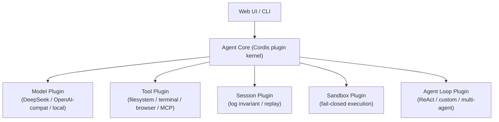
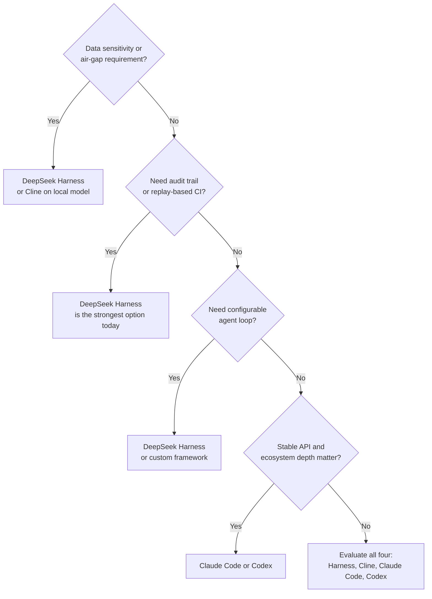

# DeepSeek Harness: A Serious Coding Agent That Deserves a Serious Look

> DeepSeek Harness isn't an agent framework you wire into your platform. It's a fully-featured coding agent — with CLI, web UI, sandbox, replay testing, and a plugin core — that ships ready to use and competes directly with Claude Code and Codex.

---

> [!NOTE]
> ### Executive TL;DR
> DeepSeek Harness (open-sourced August 13, 2026, MIT) is a production-ready coding agent built on
> a Cordis plugin core. Its formula: **Agent = Model + Harness**, where the model, tools, sandbox,
> session log, and agent loop are all replaceable plugins — but the *product* is a coding agent, not
> a framework for building one.
>
> - **What it is:** A direct competitor to Claude Code, Codex, Cline, and OpenCode — open-source, self-hostable, model-agnostic.
> - **Where it wins:** Full auditability, replay-based CI testing, configurable agent loop, open ecosystem, no vendor lock-in.
> - **Where it still has gaps:** Pre-1.0 API surface, thin benchmark documentation, smaller community ecosystem than Anthropic or OpenAI's toolchain.
> - **Bottom line:** If you're choosing a coding agent in 2026, DeepSeek Harness belongs in the shortlist — not as an architectural curiosity, but as a genuine product contender.

---

## The mistake that gets made immediately

Most engineers read "DeepSeek Harness" and file it mentally alongside LangGraph, ADK, or CrewAI — agent orchestration frameworks you adopt to build your own agents. That's wrong.

DeepSeek Harness is a **coding agent** in the same sense Claude Code and Codex are coding agents: you install it, configure it, point it at a repository, and it writes, edits, runs, and tests code for you. The plugin architecture is an internal implementation choice, not the product pitch.

The correct comparison set is:

| Tool | Vendor | License | Model | Self-host |
|---|---|---|---|---|
| Claude Code | Anthropic | Proprietary | Claude only | ❌ |
| Codex | OpenAI | Proprietary | GPT-4o family | ❌ |
| Cline | OSS | MIT | Any | ✅ |
| OpenCode | OSS | MIT | Any | ✅ |
| **DeepSeek Harness** | **DeepSeek** | **MIT** | **Any (optimized for DeepSeek)** | **✅** |

That's a very different conversation from "should we use this instead of LangGraph."

---

## What DeepSeek actually shipped

The harness delivers a complete, working coding agent out of the box. Here's what that means concretely:

### The agent loop — and the ability to change it

The standard coding agent loop looks like this:

```
Reason → call tool → observe result → reason → call tool → …
```

Every agent from AutoGPT to Claude Code runs some variant of this. The key architectural difference in DeepSeek Harness is that **the loop itself is a plugin**. You can replace it.

This isn't just theoretical. Teams that need more structured workflows — code review pipelines, multi-phase refactors, CI-driven repair loops — can wire in alternatives like:

```
Planner → parallel workers → Verifier → Critic → Fixer → Verifier
```

Without forking the whole agent. That flexibility is non-trivial and genuinely absent from Claude Code or Codex.

### Full session-log invariant

Every model call in DeepSeek Harness is checked against a complete, tamper-evident session log. The agent cannot proceed if the observed session state doesn't match the logged state.

The operational benefit: **you always know exactly what the model saw**. No guessing, no reconstructed context from partial logs. When something goes wrong — and in production, things go wrong — you replay the session and see the precise inputs and tool outputs.

Claude Code produces execution traces. Codex has usage logs. Neither enforces the session-log invariant as a hard runtime constraint the way DeepSeek Harness does.

### Replay-based CI testing

This follows directly from the session log. The workflow:

1. Record a real agent session against a real repository.
2. Commit the session log to version control.
3. In CI, replay the session against a mocked model — no API keys, no external calls, no LLM-judge flakiness.
4. Diff the output against the expected behavior.

This is how you test an agent the way you test software, not the way you hope the LLM makes similar choices on retry.

For any team running agents in production, this is a first-class capability. Current alternatives mostly rely on evals that re-invoke the model and accept non-determinism as a given. Replay-based testing is a meaningfully different and stronger guarantee.

### Fail-closed sandbox

If the sandbox cannot properly confine a tool call, it refuses to execute it and returns a structured error to the model. The model is fine-tuned to respond to that error by reformulating the request rather than retrying the same unsafe call.

The implication: privilege escalation and sandbox escape attempts degrade gracefully rather than silently succeeding or producing undefined behavior.

---

## The architecture underneath

Understanding why the product works the way it does requires a look at the Cordis plugin core.



Cordis is a dependency/lifecycle manager with a service bus — mount and unmount components, wire events between them, enforce startup/shutdown ordering. DeepSeek ships a vendored fork of it (renamed into their package scope, patched locally) specifically so the harness fully owns its framework layer rather than depending on upstream Cordis release cadence.

That's worth flagging: **the plugin kernel is not shared open infrastructure**. It's DeepSeek's private fork under MIT, which means downstream adopters can't independently track upstream Cordis changes — they depend on DeepSeek's fork. For most users that's a non-issue; for infra teams evaluating long-term maintenance cost, it's worth noting.

The model layer deserves specific attention. DeepSeek Harness is built first for DeepSeek's own V4-Pro model, which has been fine-tuned for:

- Structured tool calling with harness-specific error conventions
- Responding correctly to sandbox refusals
- Session-log-aware reasoning (the model knows what it has and hasn't seen)

That's a meaningful edge over dropping a generic model into the same harness. You can use GPT-4o or Claude through an OpenAI-compatible adapter, but you won't get the same behavioral guarantees at the edges.

---

## Where it genuinely beats Claude Code and Codex

This isn't a polite "different tools for different jobs" section. On some dimensions, DeepSeek Harness is concretely ahead.

**Auditability.** The session-log invariant is a stronger guarantee than any of the existing commercial agents offer. For regulated industries, financial services, or anywhere a code change audit trail matters, this is a real differentiator.

**Open, self-hostable, no egress.** Claude Code requires Anthropic's API and sends your code to Anthropic's infrastructure. Codex requires OpenAI. DeepSeek Harness can run entirely on-premise with a local model. For air-gapped environments or data-sensitive organizations, the choice is clear.

**Configurable loop.** If your team needs more than "reason-tool-observe," you can change the loop without maintaining a fork of the agent. Claude Code's loop is not an extension point. Codex's loop is not an extension point.

**Model agnosticism in practice.** Because the model layer is a plugin with a well-defined interface, switching from DeepSeek V4-Pro to Qwen, Kimi, or a fine-tuned internal model is a configuration change, not a migration. That matters for teams who want to benchmark models against their actual workload.

**Replay-based testing.** No other production-ready coding agent has shipped this capability. It's that simple.

---

## Where it still has gaps

Being fair in the other direction:

**Pre-1.0 API surface.** DeepSeek is explicit: the API will break before 1.0. Teams can't pin to a stable harness interface and expect continuity. Claude Code and Codex, whatever their other limitations, are products with backward-compatibility commitments.

**Ecosystem depth.** Claude Code has months of community tooling, IDE integrations, prompt libraries, and operator experience. DeepSeek Harness is weeks old. Ecosystem maturity matters for day-to-day productivity and for finding answers when things break.

**Benchmark transparency.** The published performance documentation for the release is essentially a stub. There are no published eval results with methodology, test sets, or reproducible baselines. It's hard to compare capability objectively without that.

**Single squashed commit history.** The public repository launched with no meaningful commit history — a single squash representing the full internal development. For teams that care about the security posture of their dependencies (change attribution, vulnerability tracking, code review trail), this is an unusual signal.

**Model-specific optimizations aren't free.** The harness is fine-tuned around DeepSeek V4-Pro's behavior. Plugging in a different model gets you a working agent, but some of the more interesting guarantees (sandbox failure handling, session-log-aware reasoning) depend on model behavior DeepSeek specifically trained for. Third-party models may not match.

---

## The strategic picture

Why did DeepSeek release a full coding agent alongside a harness architecture?

The answer isn't mysterious. Look at where the coding agent market was converging:

- **Anthropic:** Claude → Claude Code → closed loop.
- **OpenAI:** GPT-4o → Codex → closed loop.
- **Google:** Gemini → Jules → closed loop.

In each case, the model vendor controls both the model and the agent on top of it. The ecosystem integrates with their agent; their agent is optimized for their model. DeepSeek — primarily a model lab — faced a structural disadvantage: even if the DeepSeek model was better, the agent experience would always be shaped by someone else's product decisions.

A harness is the answer to that problem. Not as an infrastructure play (though it enables that), but as a **distribution and experience layer** for their own model. By releasing a full, competitive coding agent under MIT, DeepSeek:

1. Controls the full stack from model to developer experience.
2. Creates a reference implementation that demonstrates what DeepSeek V4-Pro can actually do.
3. Offers the open-source community something Claude Code and Codex cannot: full transparency and self-hosting.

It's a sensible strategic move, and the product is strong enough to back it.

---

## How to evaluate it for your team

The decision isn't "harness vs. framework." It's "which coding agent fits our constraints."



If your team is in an enterprise context with data governance requirements and you need a coding agent — DeepSeek Harness should be on the shortlist right now, pre-1.0 surface and all.

---

## Conclusion

The framing that matters: **DeepSeek Harness is a coding agent, not an agent framework**.

It competes with Claude Code and Codex on the same ground — developer experience, code editing, terminal execution, sandboxing, tool use, multi-step task completion. On several dimensions it is genuinely ahead: auditability via the session-log invariant, replay-based CI testing, open self-hosting, and configurable execution loops.

It has real gaps: a pre-1.0 API, thin benchmark documentation, a young ecosystem, and model-specific optimizations that only fully activate with DeepSeek V4-Pro.

The senior staff engineer read is: **this is not a curiosity to watch from the sidelines**. It's a serious product with a clear architectural thesis, released under the most permissive license in the space, from a team that has repeatedly shipped things the rest of the industry underestimated.

Evaluate it against your actual requirements. If data sovereignty, auditability, or loop customization matter to your team — you'll find it holds up.
