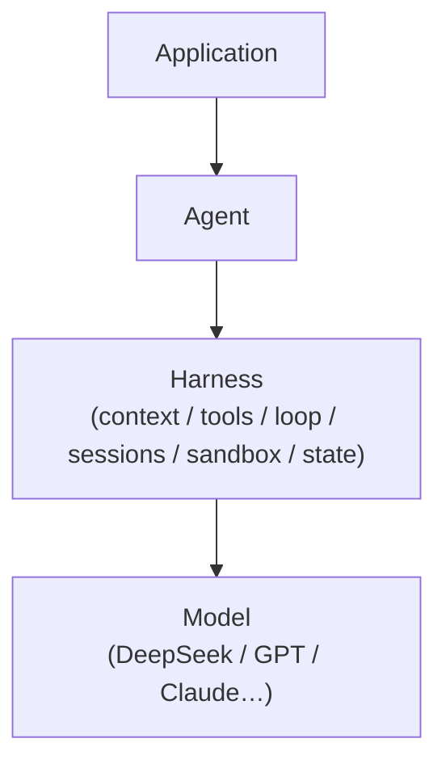
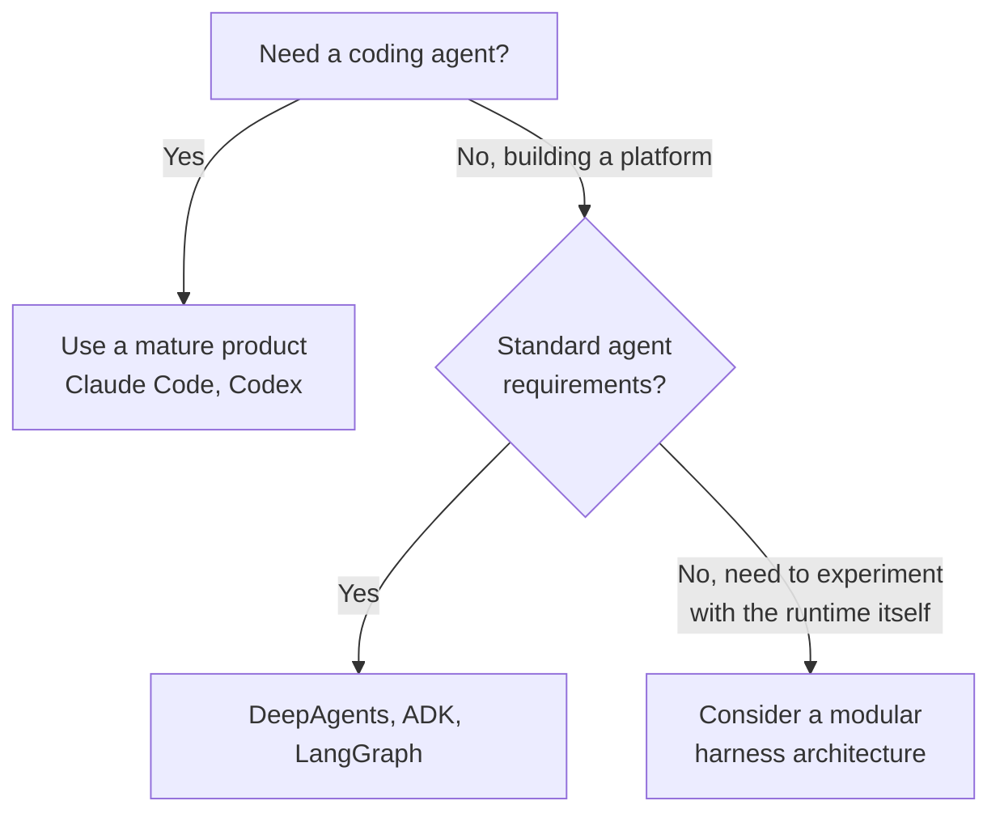

# DeepSeek Harness: Interesting Architecture, but Is It the Right Choice for Building Agents?

> A staff-engineering perspective on DeepSeek Harness — what the plugin architecture
> actually buys you, where it adds integration cost, and which teams it is genuinely built for.

---

> [!NOTE]
> ### Executive TL;DR
> DeepSeek Harness (open-sourced August 13, 2026, MIT) is a modular agent runtime built on
> the Cordis plugin framework. Its formula: **Agent = Model + Harness**, where every major
> capability — model, tools, session, sandbox, even the agent loop itself — is a replaceable
> plugin.
>
> - **Genuinely interesting for:** agent infrastructure builders, agent researchers, and teams
>   building primarily on DeepSeek models.
> - **Not a replacement for:** Claude Code, Codex, or established frameworks (DeepAgents, ADK,
>   LangGraph) for standard enterprise workloads.
> - **Key tension:** architectural flexibility has real integration and maintenance cost — and
>   the modularity argument only pays off if you actually need to swap runtime components.
> - **Bottom line:** before the architecture conversation starts, the burden of proof runs the
>   other way — what does this do materially better for *your* workload?

---

AI coding agents have created a new architectural question.

Do you use a mature product — Claude Code, Codex? Build your own on top of DeepAgents, ADK, LangGraph? Or adopt a model-specific runtime like a DeepSeek-oriented harness?

DeepSeek Harness looks attractive at first: an agent runtime built around composability, where major capabilities are treated as plugins. It's real, not hypothetical — DeepSeek open-sourced it on August 13, 2026, MIT license, built on a plugin framework called Cordis, with a stated formula: Agent = Model + Harness.

But look at the architecture from a staff-engineering angle and one distinction matters more than it seems:

**A technically interesting harness isn't automatically a compelling foundation for an enterprise agent platform.**

That distinction is the whole piece.

## Model, agent, harness — three different things

These get mixed together constantly.

The **model** is the reasoning engine — DeepSeek, GPT, Claude, Kimi, GLM.

The **agent** is model plus an execution loop plus tools: reason, call a tool, observe the result, reason again, repeat. This is the pattern the field has been running on since the 2022 ReAct paper — reason-and-act interleaved — with most of what came after (Reflexion, AutoGPT, MetaGPT) being variations on the same loop rather than a departure from it.

The **harness** is the infrastructure controlling that loop — tool execution, context and session management, permissions, filesystem access, sandboxing, orchestration, state, and sometimes the loop itself.

Stacked simply:



Which immediately explains something: **Claude Code, Codex, and an agent framework are not the same thing.**

There's arguably a fourth layer worth naming here too, one that sits between harness and model rather than inside either: the tool/context interface itself. Since MCP shipped in late 2024, that interface has become the one place the industry has actually converged — a thin, stable contract that lets harnesses and models vary independently above and below it. It's the reason a company can wire DeepSeek into LangGraph without adopting anything DeepSeek-specific at all. Harnesses compete above that line; models compete below it.

## Claude Code and Codex are solving a different problem

If the goal is "give our developers a good coding agent," you usually don't want to build an agent runtime.

You want repository exploration, code editing, terminal execution, tool calls, permissions, context management, testing, and recovery already solved — plus decent developer UX.

That's the appeal of Claude Code and Codex. They're essentially finished products.

Their internals aren't the extension point. You add MCP servers, tools, skills, integrations — but that's different from replacing the runtime itself.

Most companies shouldn't rebuild this just to prove they can. A team with a year of production telemetry and a hundred engineers iterating on recovery, permissions, and UX is going to beat a bespoke internal build almost every time — that's not really an architecture argument, it's a "who has more engineering hours" argument.

## So what's the appeal of a DeepSeek-style harness?

It's not "another coding assistant." It's the composability of the runtime itself.

Instead of:

```
Agent
 ├── filesystem
 ├── terminal
 ├── memory
 ├── model
 └── agent loop
```

think of it as:

```
Harness
 ├── model plugin
 ├── tool plugin
 ├── filesystem plugin
 ├── session plugin
 ├── sandbox plugin
 └── agent-loop plugin
```

That's what "everything is a plugin" actually means — the loop itself becomes replaceable, not a fixed implementation detail. Underneath the slogan, the actual plugin kernel — Cordis — is a fairly classic dependency/lifecycle manager: mount, unmount, wire services and events between components. It's the same instinct behind the old microkernel-versus-monolith argument from operating systems in the 90s, just aimed at agent runtimes instead of kernels. Smaller trusted core, more interfaces, more flexibility, more integration tax — the trade hasn't really changed, only the domain has.

Which is genuinely interesting if you're doing agent infrastructure work. You can experiment with something like:

```
Planner → parallel workers → Verifier → Critic → Fixer → final verifier
```

instead of being stuck with the standard:

```
Reason → tool → observe → reason → tool
```

A few concrete engineering choices in the shipped runtime are worth calling out on their own, whether or not you ever adopt the whole thing:

- **Full session-log invariant:** every model call is checked against a complete session log, so you can always reconstruct exactly what the model saw — no guessing after the fact.
- **Replay-based testing:** testing reuses those same logs — record one real session, replay it against a mocked model, diff the output. No API keys in CI, no flaky "LLM judges the test" setup.
- **Fail-closed sandbox:** if the sandbox can't confine a tool call properly, it refuses to run it, and the model is trained to ask again with a reason instead of getting stuck.

## But an elegant architecture isn't automatically a good enterprise choice

Here's where it gets harder.

Say a company already has:

```
Existing AI platform
  ├── model gateway
  ├── authentication
  ├── tools
  ├── observability
  ├── security
  ├── deployment
  ├── data layer
  └── agent framework
```

Adding another runtime means adding another integration boundary:

```
Your platform → adapter → DeepSeek Harness
                            ├── model abstraction
                            ├── tools
                            ├── sessions
                            ├── filesystem
                            └── agent loop
```

Now your engineers need to understand two architectures instead of one.

That's real cost — integration, operational complexity, debugging, security review, observability, upgrades, hiring, long-term maintenance.

Modularity doesn't mean integrating it into another modular system is cheap. It's also worth being clear-eyed about how neutral this particular piece of modularity actually is: DeepSeek didn't build on top of upstream Cordis, they vendored a fork of it — patched locally, renamed into their own package scope, explicitly so the harness would "fully own its framework layer." That's a defensible engineering call, but it means the plugin kernel isn't shared open infrastructure the way a protocol is; it's DeepSeek's private fork wearing an open license, and every future upstream Cordis release becomes a merge exercise against a fork DeepSeek controls, not something a downstream adopter can lean on independently.

## The multi-model problem matters more

Enterprises rarely want to bet everything on one model.

A realistic platform looks like:

```
Company Agent
  ├── DeepSeek (adapter)
  ├── GPT (adapter)
  └── Claude (adapter)
```

Which raises the question: **how model-neutral is the harness, really?**

Models aren't interchangeable — tool-calling semantics, reasoning state, streaming, structured output, context management, caching, parallel tool calls, multimodal input, token accounting, error handling all differ.

DeepSeek's ecosystem is actively documenting integrations with a lot of existing agent and coding tools — Claude Code, Codex, OpenCode, Pi, Cline, others.

That matters. It suggests **DeepSeek doesn't need the whole ecosystem to adopt a DeepSeek-specific harness just to use DeepSeek models.**

Their own integration guide, for example, shows DeepSeek configured as an OpenAI-compatible provider inside Pi — not requiring a DeepSeek-specific runtime.

So a company can build on DeepAgents, ADK, or LangGraph on top of DeepSeek, without touching the DeepSeek Harness at all.

One detail sharpens the neutrality question: Harness ships as an MCP *client* only — it consumes MCP servers but doesn't expose itself as one. For a project whose whole pitch is "everything is a plugin, nothing is locked in," that's a quiet signal about where DeepSeek actually wants to compete — one layer above the interoperability substrate, not inside it.

## Which is the real question

Why choose DeepSeek Harness over DeepAgents, ADK, or LangGraph?

A framework like DeepAgents starts from "here's a framework for building agents." A modular harness starts from "here's a runtime whose components can themselves be replaced."

The second gives you more freedom. Freedom has a price.

The more components you make replaceable, the more interfaces you have to define and maintain — model interface, tool interface, session interface, filesystem interface, memory interface, sandbox interface, loop interface, orchestration interface.

A staff engineer should be asking: **which of these abstractions solve a problem we actually have** — not how many things can be made pluggable.

## "Everything is a plugin" is a capability, not a justification

Plugin architectures sound impressive because they promise flexibility. Flexibility only has value when requirements actually change.

If a company genuinely needs to experiment across multiple agent loops, multiple models, multiple memory systems, multiple sandboxes — a highly modular harness earns its complexity.

But if the actual requirement is "give 5,000 developers a reliable coding assistant," the priority is reliability, security, performance, cost, developer experience, observability, support — not whether you can swap out the filesystem implementation.

That's the line between an interesting architecture and a useful product.

## Why would DeepSeek release a harness at all?

The strongest explanation is strategic, not operational.

If DeepSeek only ships a model — DeepSeek → API → someone else's agent — it controls the model layer and has almost no influence over the agent layer above it. The ecosystem could just converge toward Claude → Claude Code, GPT → Codex, and DeepSeek ends up as another model provider sitting underneath someone else's infrastructure.

A harness lets DeepSeek compete one layer up. The goal, most likely, is to influence the agent stack — not just sell API calls. Given the earlier point about MCP, this reads as fairly deliberate: DeepSeek can't win the narrow-waist layer (that standard has already converged and isn't theirs to own), so the rational move is to compete where the questions are still open — one layer up, in orchestration.

That's a reasonable strategy even if most enterprises never adopt the harness directly.

## Who this is actually for

Not "every company." Narrower than that:

| Audience | What they need |
|---|---|
| Agent infrastructure builders | Deep control over execution loops, long-running tasks, tool orchestration, model routing, memory, sandboxing, permissions, subagents, recovery, evaluation |
| Agent researchers | The ability to swap the loop itself, not just tweak prompts |
| Teams building primarily on DeepSeek | Model-specific optimizations a generic framework won't expose |

Very different needs from a team that just wants an AI pair programmer.

## The burden of proof runs the other way

The question isn't "why aren't we using DeepSeek Harness?" It's:

**"What can this actually do materially better for our workload than the mature alternatives?"**

A convincing answer looks like one of these:

| Type of advantage | What it would actually look like |
|---|---|
| Better DeepSeek-specific performance | Measurable gains from harness-level understanding of model behavior |
| Better long-running agents | A stronger architecture for tasks running hundreds or thousands of steps |
| Better runtime experimentation | Swapping loop, memory, sandbox, or orchestration is genuinely easier than in competing frameworks |
| Better DeepSeek ecosystem integration | It becomes the reference runtime for getting max performance out of DeepSeek's agent-oriented models |

Without one of those, the modularity by itself isn't enough. It's also worth weighing this against what's not there yet: the published benchmark documentation for the release is essentially a stub with no eval methodology, and the full internal development history landed as a single squashed commit with no review trail. Neither is disqualifying for a developer preview — DeepSeek is upfront that the API surface is pre-1.0 and will break — but they're the kind of thing a due-diligence process checks before the architecture conversation even starts.

## A practical decision framework

For most organizations it comes down to:



That last category is the one where DeepSeek Harness gets interesting — not because plugins are automatically better, but because the problem actually requires architectural replaceability.

## Conclusion

DeepSeek Harness's significance is easy to misread.

It's not "DeepSeek built a better Claude Code." It's also not "companies should stop using Codex and Claude Code and build their own agents."

The better read: **DeepSeek is positioning itself beyond the model layer, experimenting with the runtime layer of agent systems** — in a spot the protocol layer (MCP) has already settled around it, which is precisely why the runtime layer is still worth fighting for.

From an engineering standpoint, that doesn't make it the obvious choice. For most companies, mature coding agents remain the pragmatic pick. For teams building custom agents, established frameworks — DeepAgents, ADK, LangGraph — already give you an easier starting point for multi-model systems.

A DeepSeek-specific harness has to show a concrete advantage — DeepSeek-native model behavior, long-horizon execution, runtime-level experimentation — before the extra integration and maintenance cost is worth it. A few of its internal patterns, notably the enforced session-log invariant and the replay-based testing built on it, are worth studying on their own regardless of that verdict.

So the right conclusion isn't "DeepSeek Harness is unnecessary." It's: **DeepSeek Harness is potentially valuable at the infrastructure layer, but its value depends entirely on whether you actually need control of the harness itself.**

That's a much higher bar than "everything is a plugin."
